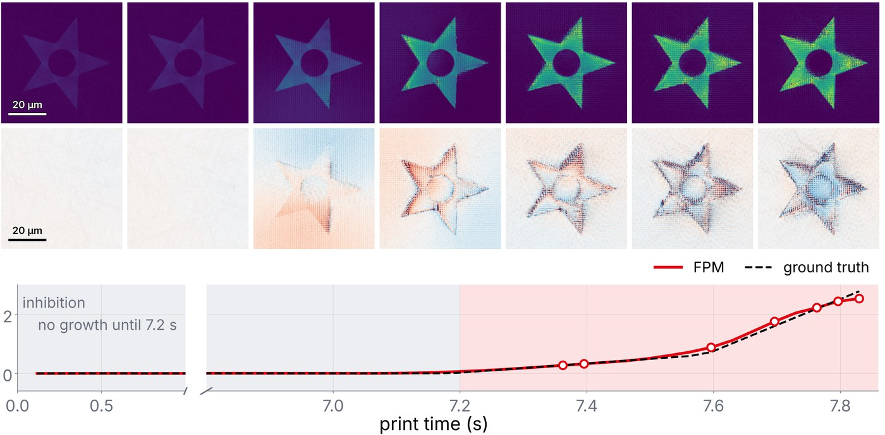
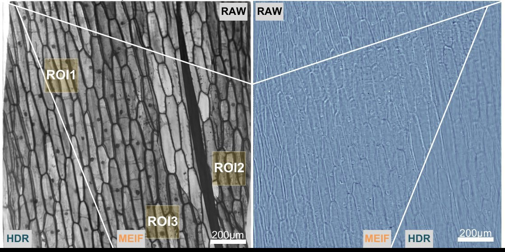

I'm a PhD student in Photonics at EPFL, where I build computational phase imaging to watch light-based 3D prints form in real time.

I work in the [Laboratory of Applied Photonics Devices (LAPD)](https://www.epfl.ch/labs/lapd/) with Prof. Christophe Moser, in the [Doctoral Program in Photonics (EDPO)](https://www.epfl.ch/education/phd/edpo-photonics/). My research combines Fourier ptychographic microscopy, quantitative phase imaging, and inverse reconstruction to monitor tomographic volumetric additive manufacturing (TVAM) and holographic fabrication in situ.

Before EPFL, I studied Physics at Lanzhou University and completed the MSc in Physics of Life at the [Biozentrum, University of Basel](https://www.biozentrum.unibas.ch), as the program's [first graduate](https://www.biozentrum.unibas.ch/education/degree-programms/msc-in-physics-of-life/interview-zhiping-wang). Along the way I worked on cryo-electron tomography reconstruction, 3D behavioural imaging of *Drosophila*, and wide-field Fourier ptychography at the Chinese Academy of Sciences.

## Research Highlights {#research}

<ul class="cards">
<li><a class="card" href="research.html#phd">

PhD · EPFL · 2026 –<h3>Phase imaging for light-based 3D printing</h3>
Fourier ptychography and differential phase contrast to monitor TVAM and holographic prints as they cure.

</a></li>
<li><a class="card" href="research.html#thesis">
<video autoplay muted loop playsinline preload="metadata" poster="assets/video/fly-grooming-loop-poster.jpg" aria-label="Side view of a fruit fly grooming in the arena"><source src="assets/video/fly-grooming-loop.mp4" type="video/mp4"></video>

MSc thesis · Basel · 2025 – 2026<h3>Multi-view 3D tracking of fruit flies</h3>
Mirror-based arena, DeepLabCut keypoints, 3D reconstruction and sleep/behaviour classifiers.

</a></li>
<li><a class="card" href="research.html#fpm">

Internship · CAS · 2023 – 2024<h3>Wide-field Fourier ptychographic microscopy</h3>
Multi-exposure fusion and feature-domain reconstruction; two first/co-first-author papers.

</a></li>
</ul>

## News {#news}

<ul class="timeline">
  <li><time>Aug 2026</time>Joined EPFL as a PhD student in the Doctoral Program in Photonics, at the <a href="https://www.epfl.ch/labs/lapd/">Laboratory of Applied Photonics Devices (LAPD)</a>.</li>
  <li><time>Jun 8, 2026</time>Successfully defended my Master's thesis in Physics of Life at the University of Basel.</li>
  <li><time>Nov 3, 2025</time>Gave my presentation and completed my first Master's project: Optimal Back-Projection for Tomography.</li>
  <li><time>May 7, 2025</time><em>Fusion-based enhancement of multi-exposure Fourier ptychographic microscopy</em> was accepted by <em>Advanced Photonics Nexus</em>. <a href="publications/publication.html">Read more</a></li>
  <li><time>Feb 28, 2025</time>Joined Knut Drescher's lab for my second Master's project, focusing on dual-view 3D imaging and behavioural analysis in <em>Drosophila</em>.</li>
  <li><time>Feb 26, 2025</time>My article <em>Wide-field quantitative phase imaging without slicing via feature-domain Fourier ptychographic microscopy</em> was accepted by <em>Optics and Laser Technology</em>.</li>
</ul>

Older news

<ul class="timeline">
  <li><time>Jan 14, 2025</time>My co-authored article <em>Fast full-color pathological imaging using Fourier ptychographic microscopy via closed-form model-based colorization</em> was accepted by <em>Advanced Photonics Nexus</em>.</li>
  <li><time>Nov 25, 2024</time>Joined Ben Engel's lab for my first Master's project, focusing on algorithmic improvements for cryo-EM 3D reconstruction.</li>
  <li><time>Sep 1, 2024</time>Moved to Basel to pursue a Master's degree in Physics of Life at the Biozentrum with a scholarship.</li>
  <li><time>Aug 2, 2024</time>My co-authored article <a href="https://www.mdpi.com/2073-4409/13/4/324"><em>Fourier Ptychographic Microscopy 10 Years On: A Review</em></a> was accepted by <em>Cells</em>.</li>
  <li><time>Jun 21, 2024</time>Graduated with a Bachelor's degree from Lanzhou University, one of 8,964 graduates that year.</li>
  <li><time>Apr 11, 2024</time>My co-authored article <em>A linear-space-variant model for Fourier ptychographic microscopy</em> was accepted by <em>Optics Letters</em>.</li>
  <li><time>Dec 17, 2020</time>Reached the summit of <a href="hiking%26photos/readme2.html">Haier Dang</a> (30°51'N 102°53'E, 4470 m).</li>
</ul>

## Research Interests {#interests}

I am interested in computational and optical imaging systems, especially their applications in light-based 3D printing, biological analysis, and 3D reconstruction. My work is driven by the idea of combining hardware design, computational models, and data-driven analysis to extract meaningful information from complex imaging systems.

<ul class="chips">
<li>Computational &amp; quantitative phase imaging</li>
<li>Fourier ptychography · DPC</li>
<li>In-situ monitoring of TVAM &amp; holographic fabrication</li>
<li>3D imaging and reconstruction</li>
<li>Imaging-based biological analysis</li>
<li>Joint optimization of algorithms and hardware</li>
</ul>

## At a Glance {#education}

<h3>Education</h3>
<ul>
<li><strong>PhD, Doctoral Program in Photonics (EDPO)</strong>, EPFL · LAPD, Prof. Christophe Moser · Aug 2026 – present</li>
<li><strong>MSc in Physics of Life</strong>, Biozentrum, University of Basel · Sep 2024 – Jun 2026 · thesis defended Jun 8, 2026; first graduate of the program; Biozentrum Master's Fellowship</li>
<li><strong>BSc in Physics</strong> (Magnetism Track), Lanzhou University · Sep 2020 – Jul 2024 · GPA 85.25/100, ranked 4/20</li>
</ul>

<h3 id="honors">Honors and Awards</h3>
<ul>
<li>EPFL Excellence in Engineering (E3) Fellowship · 2025</li>
<li>Biozentrum Master's Fellowship, University of Basel · 2024 – 2026</li>
<li>Excellent Bachelor's Thesis, Lanzhou University · 2024</li>
<li>Outstanding Student Scholarship, Lanzhou University · 2022, 2023</li>
<li>China Undergraduate Physics Tournament (Northwest Region) · First Prize 2021, Second Prize 2022</li>
</ul>

<h3 id="teaching">Teaching</h3>
<ul>
<li>Teaching Assistant, ME-413 <em>Introduction to Additive Manufacturing</em>, EPFL · Sep 2026 – present</li>
<li>Teaching Assistant, <em>Computational Physics</em>, Lanzhou University · Sep 2021 – Jan 2022</li>
</ul>

<h3 id="skills">Skills</h3>
<ul class="chips">
<li>Python · PyTorch · TensorFlow</li>
<li>OpenCV · NumPy · pandas</li>
<li>MATLAB · Mathematica · C/C++ · LaTeX</li>
<li>FPM · QPI · phase retrieval</li>
<li>Inverse reconstruction · image processing</li>
<li>CUDA/GPU · HPC/SLURM</li>
<li>DeepLabCut · MuJoCo · Autodesk Inventor</li>
</ul>

Outside the lab I enjoy [hiking](hiking%26photos/readme2.html), [photography](https://500px.com.cn/ZhipingWANG), and travel.

## Get in Touch {#contact}

The most reliable way to reach me is by email: <zhiping.wang@epfl.ch> or <zhiping.swiss@gmail.com>.

<a class="btn" href="https://github.com/Wang-Zhiping">GitHub</a>
<a class="btn" href="https://orcid.org/0009-0004-9890-9809">ORCID</a>
<a class="btn" href="https://www.linkedin.com/in/ZhipingWang818">LinkedIn</a>

<small class="muted">Non-academic: [500px](https://500px.com.cn/ZhipingWANG) · [bilibili](https://space.bilibili.com/15823831)</small>
