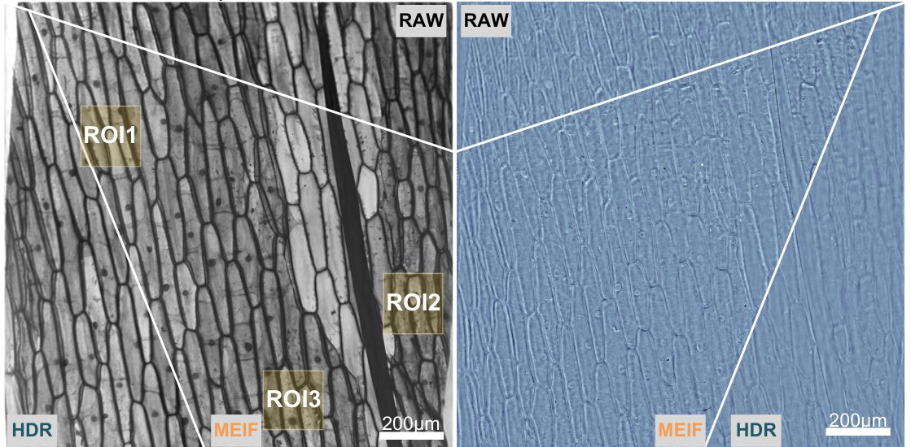
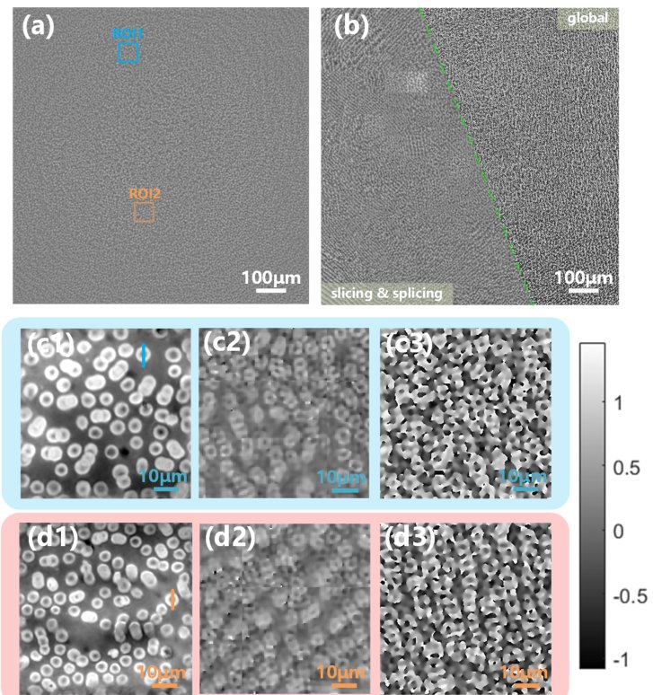
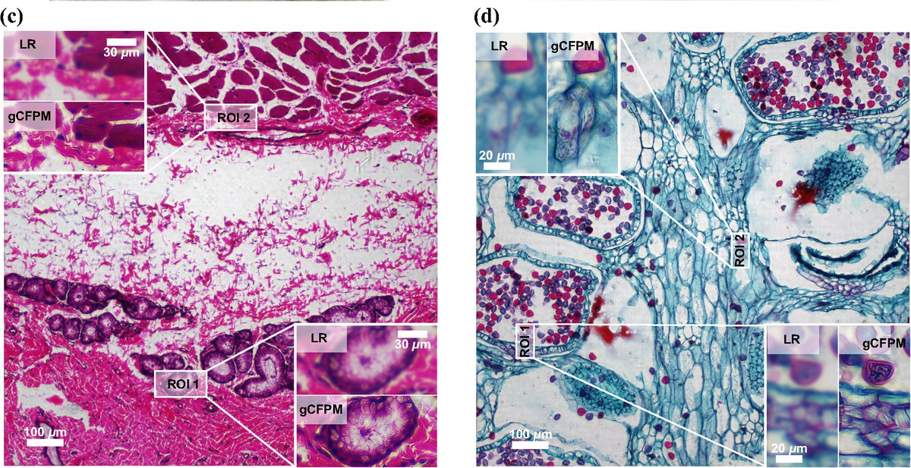
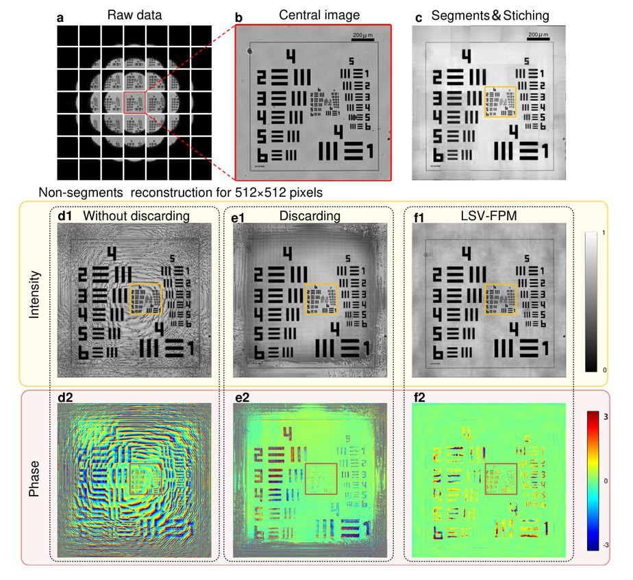
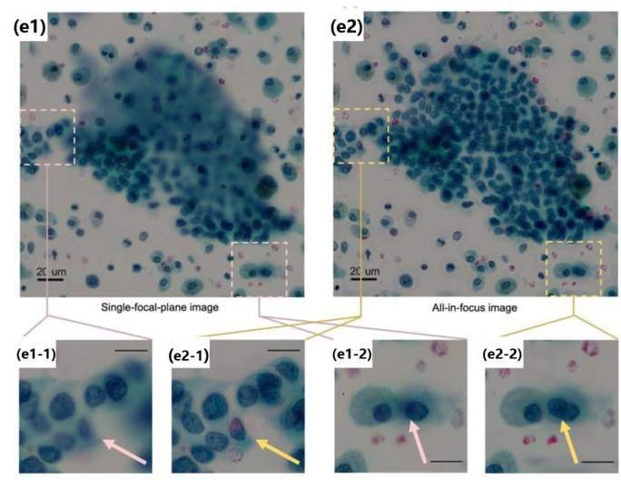

† denotes equal contribution. Underlined = me.

## Journal Articles

<article class="pub">

<h3>Fusion-based enhancement of multi-exposure Fourier ptychographic microscopy</h3>

Zhiping Wang, Tianci Feng, Aiye Wang, Jinghao Xu, and An Pan

<em>Advanced Photonics Nexus</em> 4(4), 046001 (2025)

<a href="https://www.spiedigitallibrary.org/journals/advanced-photonics-nexus/volume-4/issue-04/046001/Fusion-based-enhancement-of-multi-exposure-Fourier-ptychographic-microscopy/10.1117/1.APN.4.4.046001.full">Publisher</a> <a href="https://doi.org/10.1117/1.APN.4.4.046001">DOI</a>

</article>

<article class="pub">

<h3>Wide-field quantitative phase imaging without slicing via feature-domain Fourier ptychographic microscopy</h3>

Fannuo Xu†, Zhiping Wang†, Zipei Wu, and An Pan

<em>Optics &amp; Laser Technology</em> 187, 112727 (2025)

<a href="https://www.sciencedirect.com/science/article/pii/S0030399225003159">Publisher</a> <a href="https://doi.org/10.1016/j.optlastec.2025.112727">DOI</a>

</article>

<article class="pub">

<h3>Fast full-color pathological imaging using Fourier ptychographic microscopy via closed-form model-based colorization</h3>

Yanqi Chen, Jiurun Chen, Zhiping Wang, Yuting Gao, Yonghong He, Yishi Shi, and An Pan

<em>Advanced Photonics Nexus</em> 4(2), 026001 (2025)

<a href="https://www.spiedigitallibrary.org/journals/advanced-photonics-nexus/volume-4/issue-2/026001/Fast-full-color-pathological-imaging-using-Fourier-ptychographic-microscopy-via/10.1117/1.APN.4.2.026001.full">Publisher</a> <a href="https://doi.org/10.1117/1.APN.4.2.026001">DOI</a>

</article>

<article class="pub">

<h3>Linear-space-variant model for Fourier ptychographic microscopy</h3>

Tianci Feng, Aiye Wang, Zhiping Wang, Yizheng Liao, and An Pan

<em>Optics Letters</em> 49(10), 2617–2620 (2024)

<a href="https://opg.optica.org/ol/abstract.cfm?uri=ol-49-10-2617">Publisher</a> <a href="https://doi.org/10.1364/OL.522745">DOI</a>

</article>

<article class="pub">

<h3>Fourier ptychographic microscopy 10 years on: a review</h3>

Fannuo Xu, Zipei Wu, Chao Tan, Yizheng Liao, Zhiping Wang, Keru Chen, and An Pan

<em>Cells</em> 13(4), 324 (2024)

<a href="https://www.mdpi.com/2073-4409/13/4/324">Publisher</a> <a href="cells-13-00324.pdf">PDF</a> <a href="https://doi.org/10.3390/cells13040324">DOI</a>

</article>

## Theses and Reports

<h3>3D Multi-View Tracking and Behavioral Analysis of <em>Drosophila</em></h3>

Master's thesis, Biozentrum, University of Basel &middot; Advisors: Prof. Anissa Kempf and Dr. Alexandra Medeiros &middot; defended Jun 8, 2026

<h3>Optimal Filtered Back-Projection for Cryo-electron Tomography</h3>

Master's project report, University of Basel &middot; Advisors: Dr. Ricardo Righetto &amp; Dr. Valentin Debarnot &middot; 2025

<a href="Zhiping_Report_cryo_opfbp.pdf">Report (PDF)</a>

<h3>Exploring Advancements in Slicing-free Fourier Ptychographic Microscopy</h3>

Bachelor's thesis, Lanzhou University &middot; Advisors: Dr. Hao Jia (Lanzhou University &amp; KAUST) and Dr. An Pan (Chinese Academy of Sciences) &middot; 2024

<ul>
<li>Summarized my work on Fourier ptychographic microscopy.</li>
<li>Rated "Excellent" at the oral defense (Excellent Bachelor's Thesis award).</li>
</ul>

## Posters and Talks

<h3>Towards Computational Phase Imaging for Monitoring Light-Based Fabrication</h3>

Poster &middot; Zhiping Wang, Felix Wechsler, Jonathan Dong, Christophe Moser &middot; EPFL &middot; 2026

<a href="Wang_2026_poster_phase_imaging_SHVAM.pdf">Poster (PDF)</a>

